<p align="center">
  <a href="https://visiontrail.github.io/codex-film-studio/?lang=en">
    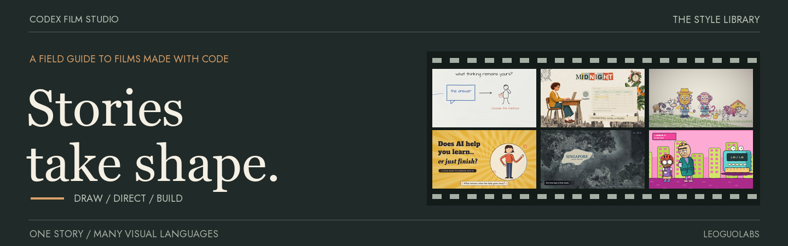
  </a>
</p>

<h1 align="center">Codex Film Studio — Stories take shape.</h1>

<p align="center">
  <strong>A visual language for your next film.</strong><br>
  Choose a style, bring a story, and build it with Codex.<br>
  Picture, narration, camera and sound on one timeline.
</p>

<p align="center">
  <a href="https://visiontrail.github.io/codex-film-studio/?lang=en"><strong>Open the style library ↗</strong></a> ·
  <a href="#the-style-atlas">Explore styles</a> ·
  <a href="#make-your-film">Start creating</a> ·
  <a href="CONTRIBUTING.md">Contribute</a> ·
  <a href="README.zh-CN.md">简体中文</a>
</p>

<p align="center">
  <a href="https://x.com/LeoGuoLabs"></a>
</p>

<br>

## The style atlas

<!-- style-atlas:start -->

<table>
<tr>
<td width="38%" valign="middle"><a href="https://visiontrail.github.io/codex-film-studio/styles/whiteboard/studio/index.html?lang=en">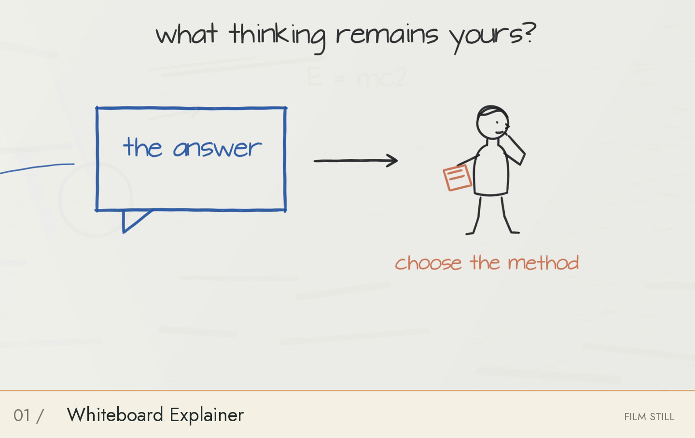</a></td>
<td width="62%" valign="top">
<sub>01 / <code>whiteboard</code></sub>
<h3>Whiteboard Explainer</h3>
<sub>白板讲解</sub>
<p>One persistent board, handwritten ideas, moving markers and story-driven line characters.</p>
<p><b>Published sample</b> · <a href="https://visiontrail.github.io/codex-film-studio/styles/whiteboard/studio/index.html?lang=en">▶ Watch online</a></p>
</td>
</tr>
<tr>
<td width="38%" valign="middle"><a href="https://visiontrail.github.io/codex-film-studio/styles/art-collage/showcase/index.html?lang=en#film">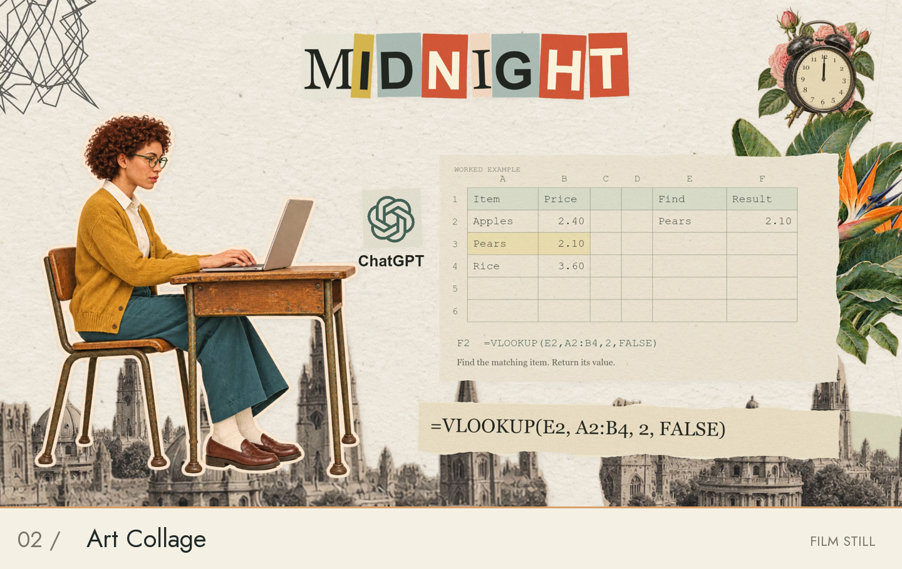</a></td>
<td width="62%" valign="top">
<sub>02 / <code>art-collage</code></sub>
<h3>Art Collage</h3>
<sub>艺术拼贴</sub>
<p>Paper cutouts, layered typography and physical collage motion.</p>
<p><b>Executable production kit</b> · <a href="https://visiontrail.github.io/codex-film-studio/styles/art-collage/showcase/index.html?lang=en#film">▶ Watch online</a></p>
</td>
</tr>
<tr>
<td width="38%" valign="middle"><a href="https://visiontrail.github.io/codex-film-studio/styles/crayon-book/showcase/index.html?lang=en">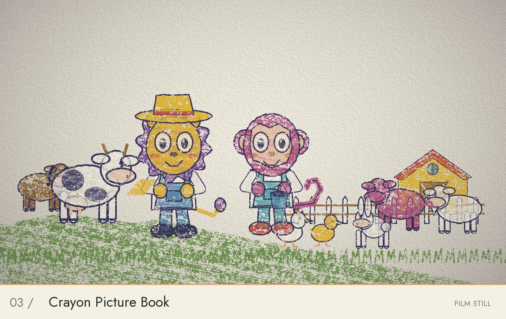</a></td>
<td width="62%" valign="top">
<sub>03 / <code>crayon-book</code></sub>
<h3>Crayon Picture Book</h3>
<sub>蜡笔绘本</sub>
<p>Wax pigment, textured paper, hand-drawn reveals and physical book motion.</p>
<p><b>Executable production kit</b> · <a href="https://visiontrail.github.io/codex-film-studio/styles/crayon-book/showcase/index.html?lang=en">▶ Watch online</a></p>
</td>
</tr>
<tr>
<td width="38%" valign="middle"><a href="https://visiontrail.github.io/codex-film-studio/styles/midcentury-cartoon/showcase/index.html?lang=en">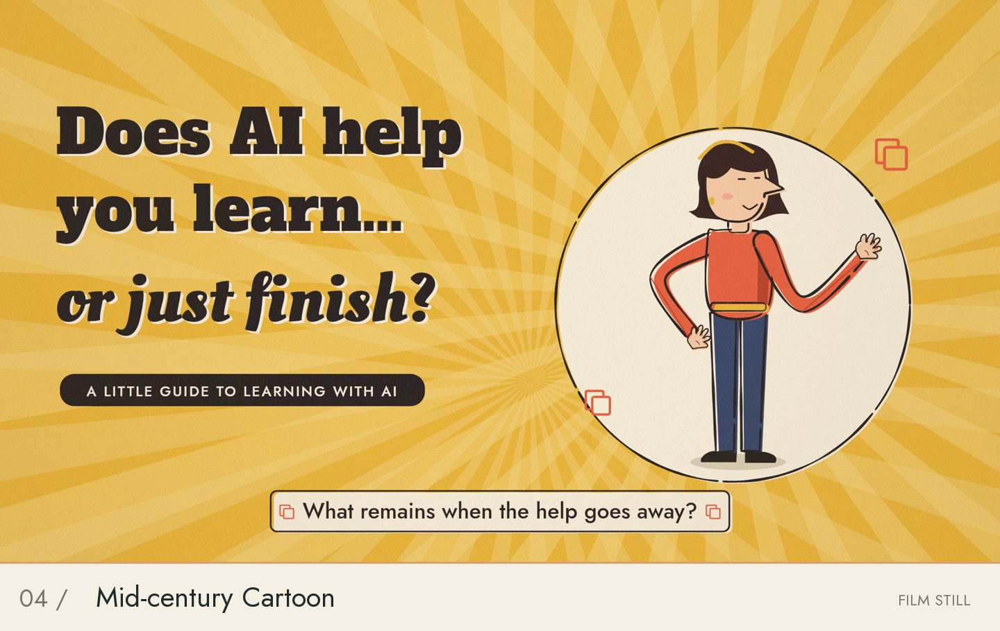</a></td>
<td width="62%" valign="top">
<sub>04 / <code>midcentury-cartoon</code></sub>
<h3>Mid-century Cartoon</h3>
<sub>50 年代平涂卡通</sub>
<p>Misregistered flat colour, broken ink, held poses and jazz.</p>
<p><b>Executable production kit</b> · <a href="https://visiontrail.github.io/codex-film-studio/styles/midcentury-cartoon/showcase/index.html?lang=en">▶ Watch online</a></p>
</td>
</tr>
<tr>
<td width="38%" valign="middle"><a href="https://visiontrail.github.io/codex-film-studio/styles/satellite-briefing/showcase/index.html?lang=en">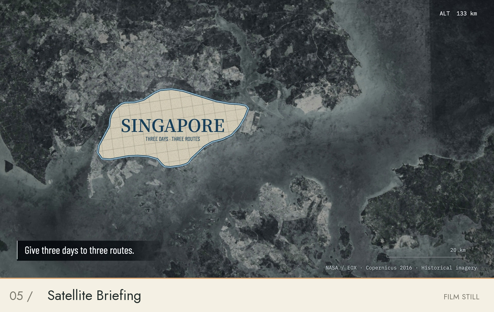</a></td>
<td width="62%" valign="top">
<sub>05 / <code>satellite-briefing</code></sub>
<h3>Satellite Briefing</h3>
<sub>卫星影像／地理简报</sub>
<p>Geographic camera, satellite imagery and measured annotations.</p>
<p><b>Executable production kit</b> · <a href="https://visiontrail.github.io/codex-film-studio/styles/satellite-briefing/showcase/index.html?lang=en">▶ Watch online</a></p>
</td>
</tr>
<tr>
<td width="38%" valign="middle"><a href="https://visiontrail.github.io/codex-film-studio/styles/scifi-sitcom/showcase/index.html?lang=en">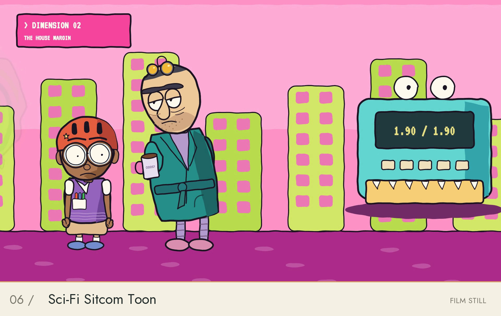</a></td>
<td width="62%" valign="top">
<sub>06 / <code>scifi-sitcom</code></sub>
<h3>Sci-Fi Sitcom Toon</h3>
<sub>科幻情景喜剧卡通</sub>
<p>Flat cartoon drawing, contrasting performances and spatial comedy.</p>
<p><b>Executable production kit</b> · <a href="https://visiontrail.github.io/codex-film-studio/styles/scifi-sitcom/showcase/index.html?lang=en">▶ Watch online</a></p>
</td>
</tr>
<tr>
<td width="38%" valign="middle"><a href="https://visiontrail.github.io/codex-film-studio/styles/microgame/showcase/index.html?lang=en#films">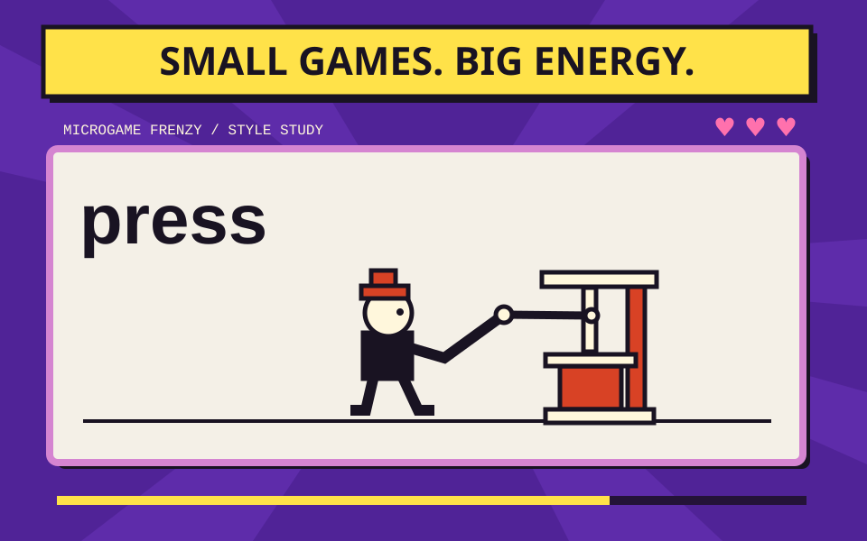</a></td>
<td width="62%" valign="top">
<sub>07 / <code>microgame</code></sub>
<h3>Microgame Frenzy</h3>
<sub>极速微游戏</sub>
<p>Rapid command-action-result games with changing materials, lives and accelerating rhythm.</p>
<p><b>Executable production kit</b> · <a href="https://visiontrail.github.io/codex-film-studio/styles/microgame/showcase/index.html?lang=en#films">▶ Watch online</a></p>
</td>
</tr>
<tr>
<td width="38%" valign="middle"><a href="https://visiontrail.github.io/codex-film-studio/styles/art-deco/showcase/index.html?lang=en#films"></a></td>
<td width="62%" valign="top">
<sub>08 / <code>art-deco</code></sub>
<h3>Art Deco</h3>
<sub>装饰艺术</sub>
<p>Black lacquer, graded brass, faceted figures and spatial mechanical motion.</p>
<p><b>Executable production kit</b> · <a href="https://visiontrail.github.io/codex-film-studio/styles/art-deco/showcase/index.html?lang=en#films">▶ Watch online</a></p>
</td>
</tr>
<tr>
<td width="38%" valign="middle"><a href="https://visiontrail.github.io/codex-film-studio/styles/caption-news/showcase/index.html?lang=en#screening">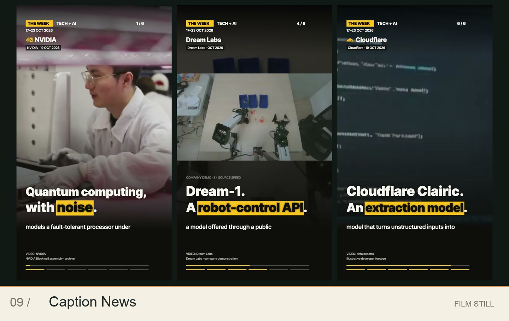</a></td>
<td width="62%" valign="top">
<sub>09 / <code>caption-news</code></sub>
<h3>Caption News</h3>
<sub>字幕新闻</sub>
<p>Large editorial captions, yellow emphasis, ledger graphics and kinetic entrances.</p>
<p><b>Executable production kit</b> · <a href="https://visiontrail.github.io/codex-film-studio/styles/caption-news/showcase/index.html?lang=en#screening">▶ Watch online</a></p>
</td>
</tr>
<tr>
<td width="38%" valign="middle"><a href="https://visiontrail.github.io/codex-film-studio/styles/line-chart-comedy/showcase/index.html?lang=en#films">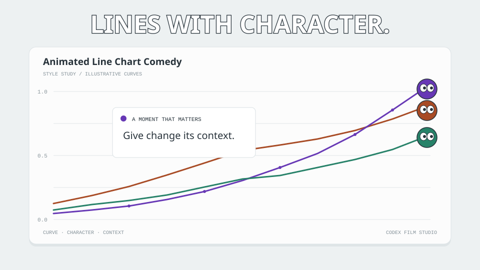</a></td>
<td width="62%" valign="top">
<sub>10 / <code>line-chart-comedy</code></sub>
<h3>Animated Line Chart Comedy</h3>
<sub>动态折线图喜剧</sub>
<p>A quiet chart interface with growing lines, expressive endpoint tokens, event cards and comic motion accents.</p>
<p><b>Executable production kit</b> · <a href="https://visiontrail.github.io/codex-film-studio/styles/line-chart-comedy/showcase/index.html?lang=en#films">▶ Watch online</a></p>
</td>
</tr>
<tr>
<td width="38%" valign="middle"><a href="https://visiontrail.github.io/codex-film-studio/styles/lidar-survey/showcase/index.html?lang=en#films">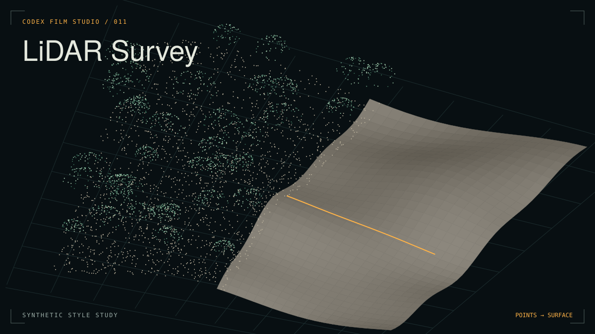</a></td>
<td width="62%" valign="top">
<sub>11 / <code>lidar-survey</code></sub>
<h3>LiDAR Survey</h3>
<sub>点云测绘</sub>
<p>Measured point clouds, canopy peeling, raking-lit terrain and fine sections, carried by one continuous camera move.</p>
<p><b>Executable production kit</b> · <a href="https://visiontrail.github.io/codex-film-studio/styles/lidar-survey/showcase/index.html?lang=en#films">▶ Watch online</a></p>
</td>
</tr>
<tr>
<td width="38%" valign="middle"><a href="https://visiontrail.github.io/codex-film-studio/styles/newsreel/showcase/index.html?lang=en#screening"></a></td>
<td width="62%" valign="top">
<sub>12 / <code>newsreel</code></sub>
<h3>Newsreel</h3>
<sub>复古新闻片</sub>
<p>Archival pictures, spinning headlines, nine-card montages and a voice from the projection booth.</p>
<p><b>Executable production kit</b> · <a href="https://visiontrail.github.io/codex-film-studio/styles/newsreel/showcase/index.html?lang=en#screening">▶ Watch online</a></p>
</td>
</tr>
<tr>
<td width="38%" valign="middle"><a href="https://visiontrail.github.io/codex-film-studio/styles/exploded-teardown/showcase/index.html?lang=en#screening">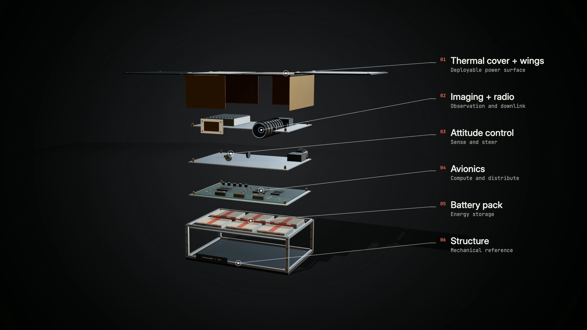</a></td>
<td width="62%" valign="top">
<sub>13 / <code>exploded-teardown</code></sub>
<h3>Exploded Teardown</h3>
<sub>爆炸拆解</sub>
<p>Dark-studio objects, staggered layer separation, material close-ups and precise engineering annotations.</p>
<p><b>Executable production kit</b> · <a href="https://visiontrail.github.io/codex-film-studio/styles/exploded-teardown/showcase/index.html?lang=en#screening">▶ Watch online</a></p>
</td>
</tr>
<tr>
<td width="38%" valign="middle"><a href="https://visiontrail.github.io/codex-film-studio/styles/halftone-dossier/showcase/index.html?lang=en#screening">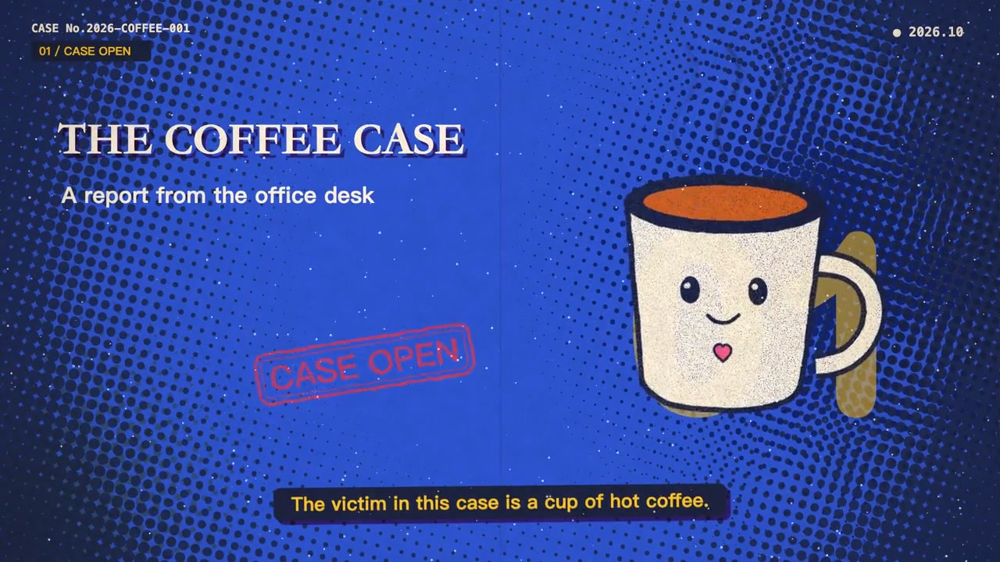</a></td>
<td width="62%" valign="top">
<sub>14 / <code>halftone-dossier</code></sub>
<h3>Halftone Dossier</h3>
<sub>复古半调案卷</sub>
<p>Warm archive paper, spot-ink dots, offset headlines and physical stamps turn a story into a trail of exhibits.</p>
<p><b>Authoring starter</b> · <a href="https://visiontrail.github.io/codex-film-studio/styles/halftone-dossier/showcase/index.html?lang=en#screening">▶ Watch online</a></p>
</td>
</tr>
<tr>
<td width="38%" valign="middle"><a href="https://visiontrail.github.io/codex-film-studio/styles/prismatic-atlas/showcase/index.html?lang=en#screening"></a></td>
<td width="62%" valign="top">
<sub>15 / <code>prismatic-atlas</code></sub>
<h3>Prismatic Atlas</h3>
<sub>棱彩图谱</sub>
<p>Saturated vector worlds, inhabited isometric scenes and clear mechanisms connected by purposeful changes of scale.</p>
<p><b>Material toolkit</b> · <a href="https://visiontrail.github.io/codex-film-studio/styles/prismatic-atlas/showcase/index.html?lang=en#screening">▶ Watch online</a></p>
</td>
</tr>
<tr>
<td width="38%" valign="middle"><a href="https://visiontrail.github.io/codex-film-studio/styles/hologram-hud/showcase/index.html?lang=en#screening">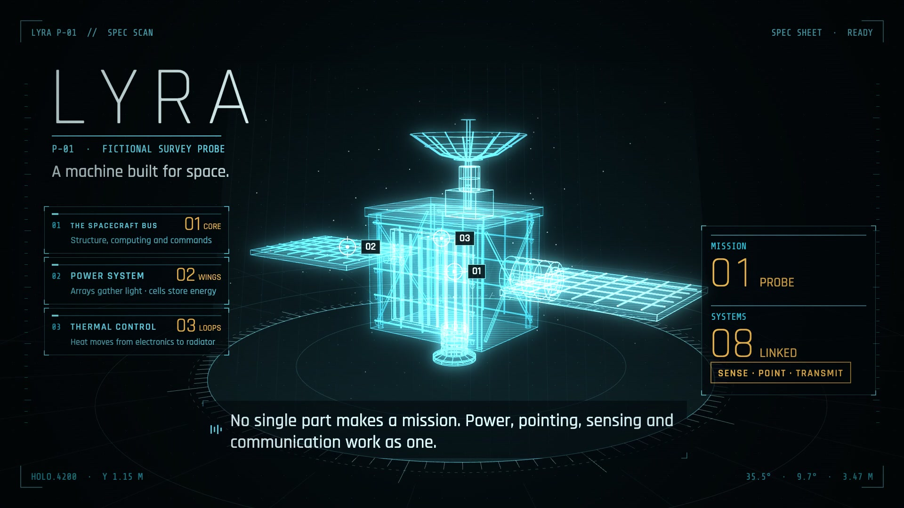</a></td>
<td width="62%" valign="top">
<sub>16 / <code>hologram-hud</code></sub>
<h3>Sci-fi Hologram HUD</h3>
<sub>科幻全息 HUD</sub>
<p>Luminous wireframes, scanning planes, target locks and local exploded views reveal how an object works.</p>
<p><b>Authoring starter</b> · <a href="https://visiontrail.github.io/codex-film-studio/styles/hologram-hud/showcase/index.html?lang=en#screening">▶ Watch online</a></p>
</td>
</tr>
</table>

<!-- style-atlas:end -->

## Make your film

### 1 / Tell your Agent what to make

Open the cloned **codex-film-studio** folder in Codex or your coding Agent.
Paste a brief; the Agent chooses the tools, creates an independent film project
and prepares the environment. You do not need to run setup commands.

> Use the Mid-century Cartoon style to make a three-minute film about [subject]
> for [audience], with English narration and subtitles. Read the studio's guides,
> create the project and prepare the environment yourself, then produce the
> script, drawings, animation and sound. Review the final pictures, motion and
> audio, fix observed problems, and deliver a 1080p MP4 and editable project.
> Tell me what you actually checked.

Replace the style, subject, audience, language and duration. You can also give
an Agent a Style page link or ask it to pick a style for your story.

<details>
<summary><b>Haven’t cloned the studio yet? Give your Agent this prompt.</b></summary>

> Clone https://github.com/visiontrail/codex-film-studio.git into a new folder
> without overwriting existing files. Read AGENTS.md and the codex-film skill,
> then help me make a film from my brief. Handle setup and commands yourself.

</details>

### 2 / Or ask to recreate a sample

> Recreate the [sample title or link] in the [style] style. Find the available
> original project, assets and recorded audio. Handle project setup, rendering
> and review, then deliver the MP4 and editable project. If original sources
> are missing, tell me exactly what is needed; do not replace them with a new story.

Exact recreation needs the original composition and inputs. The Agent can use
the released whiteboard inputs; other samples require an available external
source bundle. A showcase MP4 alone may not include those sources. The
[reproduction guide](methods/reproduction.md) explains what the Agent checks.

### 3 / Watch, then direct the next revision

The Agent reads the [`codex-film` skill](.agents/skills/codex-film/SKILL.md),
[DIRECTOR.md](DIRECTOR.md), [TECHNIQUE.md](TECHNIQUE.md) and the selected style
rules, then handles the production workflow. It keeps each film in an independent
project outside this library, preserves existing projects, and returns the film
with its editable source and actual review coverage.

Review the result and ask for changes in the same conversation: “Slow down the
opening,” “Make the narration warmer,” or “Recompose this for a vertical screen.”
The Agent updates picture, narration, captions and sound together.

The Agent checks the required environment and available voice tools. If it needs
a source image, a recording or access to a voice service, it names the missing
input. For local browsing, ask it to open the studio; see the
[local showcase guide](docs/pages.md#local-style-catalog) for technical details.

<details>
<summary><b>Agent reference: whiteboard rebuild commands</b></summary>

The Agent runs these commands from the repository root:

```sh
python3 scripts/fetch_demo.py --edition short
cd styles/whiteboard/studio
npm ci
python3 -m venv .venv
.venv/bin/pip install -r requirements.txt

# Picture preview, then the full film with narration, music and marker sounds.
node scripts/render.mjs --start 0 --end 8 --width 960 --out media/preview.mp4
.venv/bin/python scripts/build.py --skip-atlases
python3 scripts/serve.py
```

Open **http://127.0.0.1:8246/**. The complete output is
`styles/whiteboard/studio/media/does-ai-help-you-learn-3min.mp4`.

For both editions, run `python3 scripts/fetch_demo.py --edition all` from the
repository root. Add `--edition long` to the studio's render/build commands;
the long output is `editions/long/media/does-ai-help-you-learn-long.mp4`.

Git contains source, fonts and instrument samples. Films, narration WAVs and
timing data come from the versioned Release, checked against SHA-256 hashes.
Cloning alone does not download films. A rebuild preserves the composition and
input audio; renderer and encoder versions can change the output bytes.

Tested on Apple Silicon macOS with Node 24 and FFmpeg 8. A Linux CI smoke check
renders a short picture preview. The speech client requires WSL on Windows.

</details>

<details>
<summary><b>Host the published showcase</b></summary>

For a fork, select **Settings → Pages → Source → GitHub Actions**, then run
**Deploy film showcase** in Actions. Pushing to `main` also triggers deployment.
The builder downloads checksum-pinned Release assets and publishes an explicit
set of homepage, catalog, preview and player files. See [deployment and local preview](docs/pages.md).

Published pages use verified web-preview bundles; local pages keep using the
retained production originals. Publishing another film requires an explicit request.

</details>

## Grow the library

All visual styles live in `styles/<id>/`; [styles.json](styles.json) records their
completion and capabilities. Shared workflows belong in `methods/`.

Contribute reusable visual rules, generic tools and blank inputs. Keep each film's
story, portraits, media and review records in its external project. Specific real
people need portraits supplied for that new film. See [CONTRIBUTING.md](CONTRIBUTING.md).

After registering a style, run `python3 scripts/update_style_index.py` to update
both README atlases and the detailed catalog. `--check` detects drift.

<details>
<summary>Continuing an older project</summary>

The former `methods/<style>/` packages now live under `styles/<style>/`.
`--method <id>` remains a deprecated alias for `--style <id>`. Existing projects
are independent copies and can continue in place. Published examples and retained
showcase entrypoints keep their original compositions.

</details>

## Credits & license

By **[LeoGuoLabs](https://x.com/LeoGuoLabs)**, built with Codex. Style-library
inspiration: [LemoLab / lemo-opuscar](https://github.com/lemomo-ai/lemo-opuscar)
by [@lemomo_ai](https://x.com/lemomo_ai).

Code, documentation and layout: [MIT](LICENSE). Original sample films and stills:
[CC BY 4.0](MEDIA-LICENSE.md). Screenshot materials retain their
[frame-source credits](docs/readme/README.md#frame-sources); fonts and instruments
retain their own licenses. See [sample credits](styles/whiteboard/studio/CREDITS.md).
[README design references and artwork notes](docs/readme/README.md).

Executable projects now include `doctor`, `check`, `preview`, `build`, `verify` and `serve` commands. The [capability table](styles/README.md#capabilities--能力与网页) separates public films, source access and rebuild scope. See [source bundle acquisition](methods/reproduction.md#portable-archives-and-acquisition).
