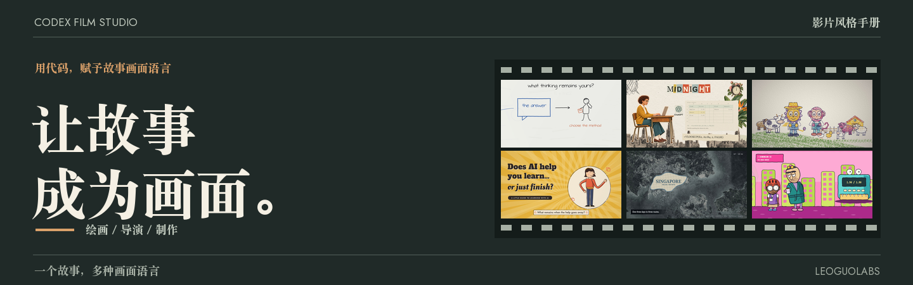
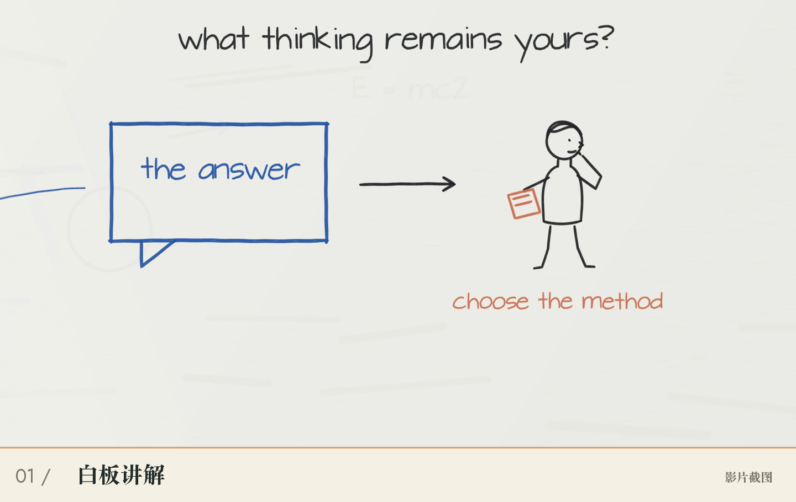
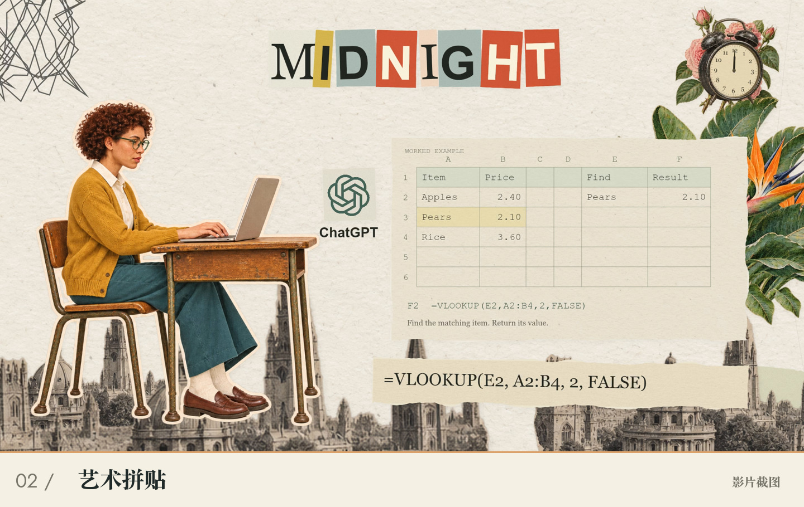
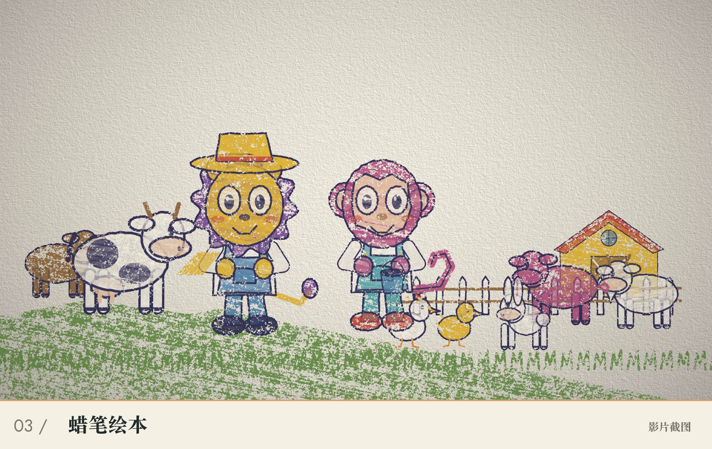
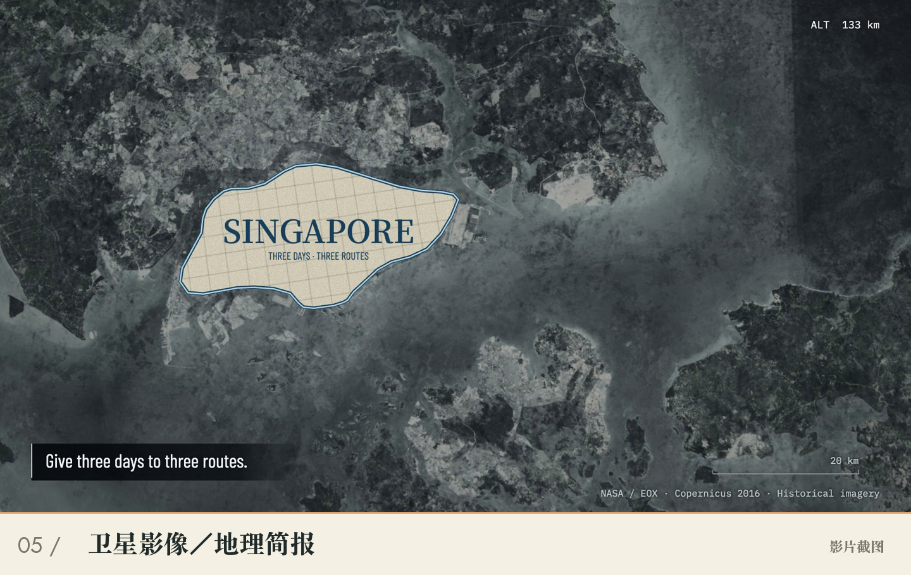
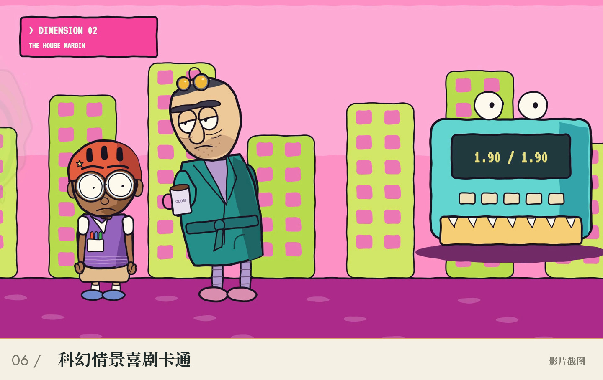
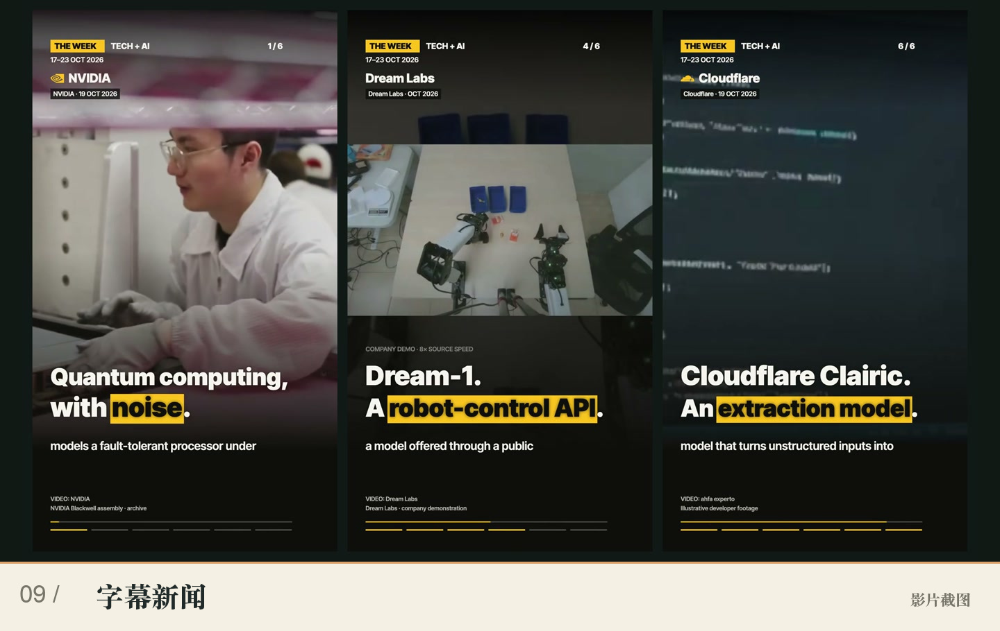
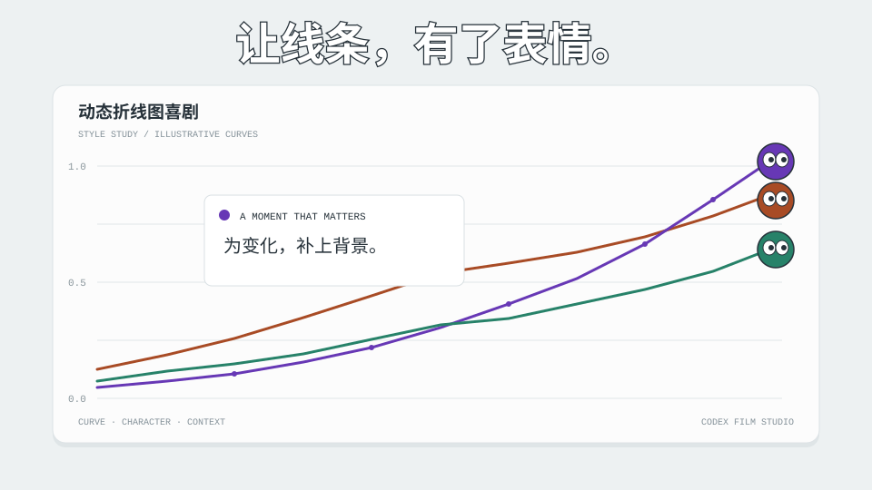
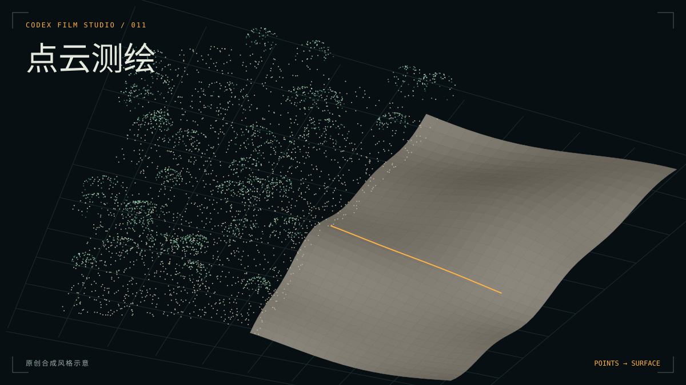
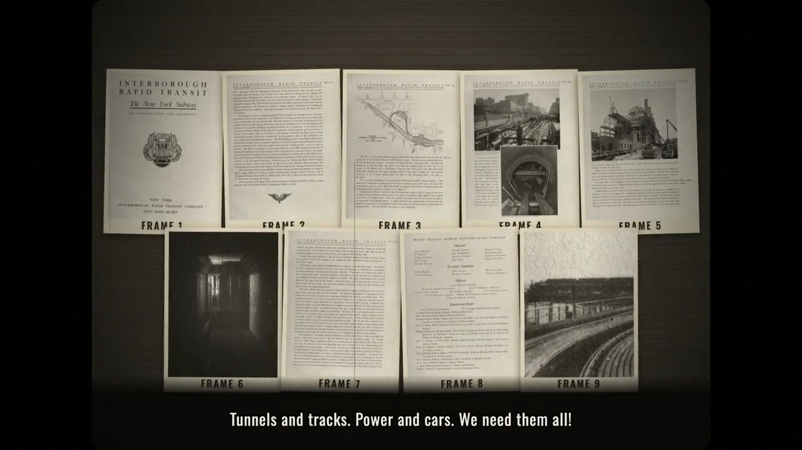

<p align="center">
  <a href="https://visiontrail.github.io/codex-film-studio/?lang=zh">
    
  </a>
</p>

<h1 align="center">Codex Film Studio — 让故事成为画面</h1>

<p align="center">
  <strong>为下一个故事，找到它的画面语言。</strong><br>
  选一种风格，带上你的故事，用 Codex 做成影片。<br>
  让画面、叙事、镜头与声音，共用一条时间轴。
</p>

<p align="center">
  <a href="https://visiontrail.github.io/codex-film-studio/?lang=zh"><strong>打开风格片库 ↗</strong></a> ·
  <a href="#风格手册">浏览风格</a> ·
  <a href="#制作你的影片">开始创作</a> ·
  <a href="CONTRIBUTING.md">参与贡献</a> ·
  <a href="README.md">English</a>
</p>

<p align="center">
  <a href="https://x.com/LeoGuoLabs"></a>
</p>

<br>

## 风格手册

<!-- style-atlas:start -->

<table>
<tr>
<td width="38%" valign="middle"><a href="https://visiontrail.github.io/codex-film-studio/styles/whiteboard/studio/index.html?lang=zh"></a></td>
<td width="62%" valign="top">
<sub>01 / <code>whiteboard</code></sub>
<h3>白板讲解</h3>
<sub>Whiteboard Explainer</sub>
<p>一块持续保留内容的白板，用手写文字、移动马克笔和线条人物逐步解释想法。</p>
<p><b>已发布样片</b> · <a href="https://visiontrail.github.io/codex-film-studio/styles/whiteboard/studio/index.html?lang=zh">▶ 在线播放</a></p>
</td>
</tr>
<tr>
<td width="38%" valign="middle"><a href="https://visiontrail.github.io/codex-film-studio/styles/art-collage/showcase/index.html?lang=zh#film"></a></td>
<td width="62%" valign="top">
<sub>02 / <code>art-collage</code></sub>
<h3>艺术拼贴</h3>
<sub>Art Collage</sub>
<p>纸张剪贴、错落字体与层叠构图，让信息通过进入、遮挡和替换形成关系。</p>
<p><b>创作起步包</b> · <a href="https://visiontrail.github.io/codex-film-studio/styles/art-collage/showcase/index.html?lang=zh#film">▶ 在线播放</a></p>
</td>
</tr>
<tr>
<td width="38%" valign="middle"><a href="https://visiontrail.github.io/codex-film-studio/styles/crayon-book/showcase/index.html?lang=zh"></a></td>
<td width="62%" valign="top">
<sub>03 / <code>crayon-book</code></sub>
<h3>蜡笔绘本</h3>
<sub>Crayon Picture Book</sub>
<p>蜡质笔触与暖纸纹理，逐笔显现的绘画配合真实的绘本翻页。</p>
<p><b>材质工具包</b> · <a href="https://visiontrail.github.io/codex-film-studio/styles/crayon-book/showcase/index.html?lang=zh">▶ 在线播放</a></p>
</td>
</tr>
<tr>
<td width="38%" valign="middle"><a href="https://visiontrail.github.io/codex-film-studio/styles/midcentury-cartoon/showcase/index.html?lang=zh"></a></td>
<td width="62%" valign="top">
<sub>04 / <code>midcentury-cartoon</code></sub>
<h3>50 年代平涂卡通</h3>
<sub>Mid-century Cartoon</sub>
<p>柔和套色、微微错位的墨线与停格姿态，配合清楚的教学表演和爵士节奏。</p>
<p><b>创作起步包</b> · <a href="https://visiontrail.github.io/codex-film-studio/styles/midcentury-cartoon/showcase/index.html?lang=zh">▶ 在线播放</a></p>
</td>
</tr>
<tr>
<td width="38%" valign="middle"><a href="https://visiontrail.github.io/codex-film-studio/styles/satellite-briefing/showcase/index.html?lang=zh"></a></td>
<td width="62%" valign="top">
<sub>05 / <code>satellite-briefing</code></sub>
<h3>卫星影像／地理简报</h3>
<sub>Satellite Briefing</sub>
<p>以地理镜头连接真实卫星影像，用克制的标注解释位置、尺度与空间关系。</p>
<p><b>创作起步包</b> · <a href="https://visiontrail.github.io/codex-film-studio/styles/satellite-briefing/showcase/index.html?lang=zh">▶ 在线播放</a></p>
</td>
</tr>
<tr>
<td width="38%" valign="middle"><a href="https://visiontrail.github.io/codex-film-studio/styles/scifi-sitcom/showcase/index.html?lang=zh"></a></td>
<td width="62%" valign="top">
<sub>06 / <code>scifi-sitcom</code></sub>
<h3>科幻情景喜剧卡通</h3>
<sub>Sci-Fi Sitcom Toon</sub>
<p>粗墨线、平涂阴影与反差表演，用反应镜头和空间变化组织喜剧节奏。</p>
<p><b>创作起步包</b> · <a href="https://visiontrail.github.io/codex-film-studio/styles/scifi-sitcom/showcase/index.html?lang=zh">▶ 在线播放</a></p>
</td>
</tr>
<tr>
<td width="38%" valign="middle"><a href="https://visiontrail.github.io/codex-film-studio/styles/microgame/showcase/index.html?lang=zh#films"></a></td>
<td width="62%" valign="top">
<sub>07 / <code>microgame</code></sub>
<h3>极速微游戏</h3>
<sub>Microgame Frenzy</sub>
<p>命令、动作与结果构成的小关卡，用媒介切换、生命计数和加速节奏连接故事。</p>
<p><b>材质工具包</b> · <a href="https://visiontrail.github.io/codex-film-studio/styles/microgame/showcase/index.html?lang=zh#films">▶ 在线播放</a></p>
</td>
</tr>
<tr>
<td width="38%" valign="middle"><a href="https://visiontrail.github.io/codex-film-studio/styles/art-deco/showcase/index.html?lang=zh#films"></a></td>
<td width="62%" valign="top">
<sub>08 / <code>art-deco</code></sub>
<h3>装饰艺术</h3>
<sub>Art Deco</sub>
<p>黑漆、渐变黄铜、切面人物与具有空间感的机械动效。</p>
<p><b>材质工具包</b> · <a href="https://visiontrail.github.io/codex-film-studio/styles/art-deco/showcase/index.html?lang=zh#films">▶ 在线播放</a></p>
</td>
</tr>
<tr>
<td width="38%" valign="middle"><a href="https://visiontrail.github.io/codex-film-studio/styles/caption-news/showcase/index.html?lang=zh#screening"></a></td>
<td width="62%" valign="top">
<sub>09 / <code>caption-news</code></sub>
<h3>字幕新闻</h3>
<sub>Caption News</sub>
<p>大字号字幕、黄色重点、账本式图表与有节奏的入场动效。</p>
<p><b>创作起步包</b> · <a href="https://visiontrail.github.io/codex-film-studio/styles/caption-news/showcase/index.html?lang=zh#screening">▶ 在线播放</a></p>
</td>
</tr>
<tr>
<td width="38%" valign="middle"><a href="https://visiontrail.github.io/codex-film-studio/styles/line-chart-comedy/showcase/index.html?lang=zh#films"></a></td>
<td width="62%" valign="top">
<sub>10 / <code>line-chart-comedy</code></sub>
<h3>动态折线图喜剧</h3>
<sub>Animated Line Chart Comedy</sub>
<p>克制的图表界面，以生长折线、端点角色、事件卡片与漫画动作讲述数据变化。</p>
<p><b>创作起步包</b> · <a href="https://visiontrail.github.io/codex-film-studio/styles/line-chart-comedy/showcase/index.html?lang=zh#films">▶ 在线播放</a></p>
</td>
</tr>
<tr>
<td width="38%" valign="middle"><a href="https://visiontrail.github.io/codex-film-studio/styles/lidar-survey/showcase/index.html?lang=zh#films"></a></td>
<td width="62%" valign="top">
<sub>11 / <code>lidar-survey</code></sub>
<h3>点云测绘</h3>
<sub>LiDAR Survey</sub>
<p>以连续空间镜头串联测绘点云、树冠剥离、侧光地表与细线剖面，让数据逐层显现。</p>
<p><b>创作起步包</b> · <a href="https://visiontrail.github.io/codex-film-studio/styles/lidar-survey/showcase/index.html?lang=zh#films">▶ 在线播放</a></p>
</td>
</tr>
<tr>
<td width="38%" valign="middle"><a href="https://visiontrail.github.io/codex-film-studio/styles/newsreel/showcase/index.html?lang=zh#screening"></a></td>
<td width="62%" valign="top">
<sub>12 / <code>newsreel</code></sub>
<h3>复古新闻片</h3>
<sub>Newsreel</sub>
<p>档案影像、旋转头条、九张纸卡与旧时播音，让故事从放映室走来。</p>
<p><b>创作起步包</b> · <a href="https://visiontrail.github.io/codex-film-studio/styles/newsreel/showcase/index.html?lang=zh#screening">▶ 在线播放</a></p>
</td>
</tr>
</table>

<!-- style-atlas:end -->

<sub>影片截图与原创风格示意分别标注；截图图版翻译画面外的标题与图注，影片画面保留原语言。
<a href="docs/readme/README.md#frame-sources">截图来源与署名</a>。</sub>

## 制作你的影片

### 1 / 选择起点

```sh
git clone https://github.com/visiontrail/codex-film-studio.git
cd codex-film-studio
python3 scripts/new_film.py --list
python3 scripts/new_film.py my-film --style midcentury-cartoon
```

所有风格使用同一个 `--style <id>` 命令。独立工程默认放在仓库外的
`../codex-film-studio-projects/my-film`，也可用 `--output /绝对路径/新项目`
指定其他外部目录。已有目标目录会保留，不会覆盖。

### 2 / 带入故事

在 Codex 中打开新项目，提供选题、观众、语言和时长，例如：

> 按本项目的风格说明，制作一个三分钟的“太阳能电池如何工作”视频。
> 需要人物和具体对象解释的地方画出来。使用英文配音，输出 1080p MP4。
> 检查渲染后的静帧和动作，试听声音，修复实际发现的问题后再让我看。

仓库的 [`codex-film` 技能](.agents/skills/codex-film/SKILL.md)组织制作流程，
会阅读三份说明：

| 阅读 | 在影片中的作用 |
| --- | --- |
| [DIRECTOR.md](DIRECTOR.md) | 故事、镜头、节奏和表演 |
| [TECHNIQUE.md](TECHNIQUE.md) | 渲染、配音、音乐和混音 |
| 所选风格的 `STYLE.md` | 绘画、材质和动作规则 |

### 3 / 制作、审查、交付

创作旁白与场景，录制或生成配音，再渲染与审查影片。
[通用制作方法](methods/README.md)负责共用流程；各风格说明补充自己的视觉与声音要求。
每个新项目都携带参考适配、素材选择与重剪交付方法。具体脚本、事实、素材和
单片验收结果留在制作项目，不进入通用方法。

白板保留可编辑的样片渲染工程；其他风格提供空白输入和通用工具，需要为新选题
编写场景与渲染器。蜡笔绘本目前是材质工具包。每部新影片都要创作自己的旁白、
画面和动作，并进行声音审查。

新配音可接入自己的 Chatterbox 兼容服务，或按段提供 WAV 录音。
复现白板样片使用发布时的音频，无需 TTS 密钥。基本环境为
**Node.js 20+、Python 3.11+、FFmpeg**，额外依赖见所选项目说明；Windows 使用 WSL。
白板样片的字体与字幕面向英文，中文制作需要重新配置字形和排版。

本地浏览：在仓库根目录运行 `python3 scripts/serve_styles.py --port 8249`，并保留对应制作项目；详见[本地网页说明](docs/pages.md#local-style-catalog)。

<details>
<summary><b>复现已发布的白板样片</b></summary>

从仓库根目录执行：

```sh
python3 scripts/fetch_demo.py --edition short
cd styles/whiteboard/studio
npm ci
python3 -m venv .venv
.venv/bin/pip install -r requirements.txt

# 先生成画面预览，再完整合成配音、音乐和笔触音效。
node scripts/render.mjs --start 0 --end 8 --width 960 --out media/preview.mp4
.venv/bin/python scripts/build.py --skip-atlases
python3 scripts/serve.py
```

打开 **http://127.0.0.1:8246/**。完整输出位于
`styles/whiteboard/studio/media/does-ai-help-you-learn-3min.mp4`。

在仓库根目录执行 `python3 scripts/fetch_demo.py --edition all` 下载两版样片及配音。
长版构建命令添加 `--edition long`，输出在
`editions/long/media/does-ai-help-you-learn-long.mp4`。

Git 包含源码、字体和乐器采样；影片、配音 WAV 与时间数据从固定版本的 Release
下载并校验 SHA-256。克隆本身不会下载影片。复现保留原构图与输入音频；不同的
渲染器和编码器版本可能生成不同的文件字节。

已在 Apple Silicon macOS、Node 24 和 FFmpeg 8 上验证。Linux CI 会渲染一段
画面预览；Windows 的语音客户端使用 WSL。

</details>

<details>
<summary><b>部署公开展示页</b></summary>

部署自己的 fork：在 **Settings → Pages → Source** 选择 **GitHub Actions**，
然后在 Actions 中运行 **Deploy film showcase**。推送到 `main` 也会触发部署。
构建会下载并校验固定版本的 Release 资源，发布明确列出的首页、目录、预览图和播放器文件。
详见[部署与本地预览说明](docs/pages.md)。

公开展示页通过校验过的 Release 资源包播放网络预览，本地页面继续使用保留工程的原片。
发布其他影片需要明确请求。

</details>

## 扩展这个风格库

所有视觉风格位于 `styles/<id>/`，由 [styles.json](styles.json)记录完成状态与能力；
跨风格通用流程放在 `methods/`。

向库内贡献可复用的视觉规则、通用工具和空白输入。每部影片的故事、肖像、媒体与
审阅记录放在外部项目。指定真实人物时，使用为新影片提供的肖像。
目录规范见 [CONTRIBUTING.md](CONTRIBUTING.md)。

登记风格后，运行 `python3 scripts/update_style_index.py`，同步中英文首页和详细目录。
使用 `--check` 检查是否遗漏更新。

<details>
<summary>继续使用旧项目</summary>

原 `methods/<style>/` 已迁入 `styles/<style>/`，`--method <id>` 保留为
`--style <id>` 的兼容别名。已创建的项目是独立副本，可以原地继续。
已发布样片和保留的展示入口维持原有构图。

</details>

## 来源与许可

由 **[LeoGuoLabs](https://x.com/LeoGuoLabs)** 使用 Codex 制作。风格库的组织方式受到
[LemoLab / lemo-opuscar](https://github.com/lemomo-ai/lemo-opuscar) 启发，
作者为 [@lemomo_ai](https://x.com/lemomo_ai)。

代码、文档与版式采用 [MIT](LICENSE)；原创样片和影片剧照采用
[CC BY 4.0](MEDIA-LICENSE.md)。截图中的素材保留各自的
[来源与署名](docs/readme/README.md#frame-sources)，字体与乐器采样保留各自许可。
白板样片的[素材出处](styles/whiteboard/studio/CREDITS.md)。
[README 设计参考与插图说明](docs/readme/README.md)。
